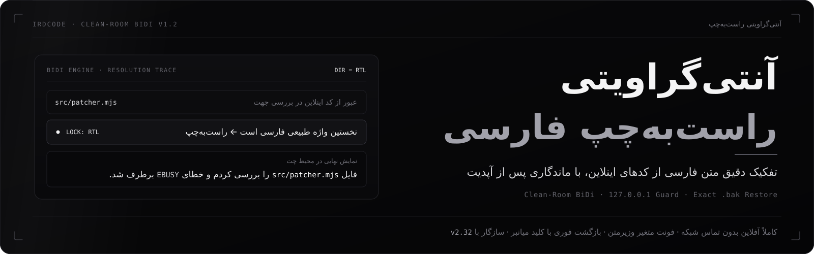
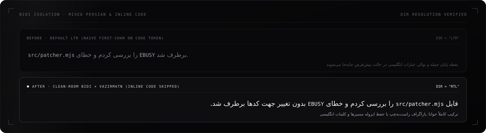

<p align="center">
  <a href="README.md">English</a> · <strong>فارسی</strong> · <a href="https://irdcode.github.io/antigravity-persian-rtl/">مستندات وب</a>
</p>

<p align="center">
  
</p>

<div dir="rtl">

# راست‌به‌چپ امن و ماندگار برای آنتی‌گراویتی (Antigravity Persian RTL)

**موتور جداسازی دوجهته (BiDi Isolate)، فونت متغیر آفلاین وزیرمتن، سخت‌سازی امنیتی کامل و لانچر خودکار ویندوز برای نسخه دسکتاپ Google Antigravity.**

محیط دسکتاپ Google Antigravity به‌صورت پیش‌فرض چپ‌به‌راست (`dir="ltr"`) طراحی شده است. وقتی پیام‌های فارسی یا عربی با نام فایل‌ها، کد خطاها و اصطلاحات انگلیسی ترکیب می‌شوند، ترتیب کلمات جابه‌جا شده و علائمی مثل نقطه و پرانتز به ابتدای خط می‌پرند.

این ابزار با تزریق کنترلر استاندارد دوجهته به `app.asar`، پاراگراف‌های فارسی و عربی را به‌صورت خودکار **راست‌به‌چپ (`dir="rtl"`)** کرده و هم‌زمان بلاک‌های کد (`pre`, `code`)، ویرایشگر Monaco و ترمینال را کاملاً **چپ‌به‌راست (`dir="ltr"`)** نگه می‌دارد.

</div>

<p align="center">
  
</p>

<p align="center">
  
</p>

<div dir="rtl">

### قابلیت‌های کلیدی موتور Clean-Room BiDi

- **نادیده گرفتن کد اینلاین، مسیر فایل و لینک در شروع جمله:** در پیاده‌سازی مستقل `src/bidi-engine.js`، هنگام تشخیص جهت پاراگراف از تگ‌های `<code>`، `<pre>`، `.font-mono`، نشانی‌های وب و مسیرهای نسبی ابتدای خط عبور می‌کنیم و با اعمال صریح `unicode-bidi: isolate !important` از به‌هم‌ریختگی خط در جمله‌هایی مثل `` `src/patcher.mjs` رو بررسی کردم `` جلوگیری می‌شود.
- **سازگاری با ساختار پنجره جدید (`BaseWindow` در `v2.32.0`):** در زمان اجرا، اول `hubContents` (ساختار `WebContentsView` در نسخه `2.32+`) بررسی شده و در نسخه‌های قبلی (`2.31.x`) از `win.webContents` استفاده می‌شود.
- **بازگشت غیرمخرب با `Alt+R`:** هنگام خاموش کردن موقت راست‌به‌چپ، ویژگی `dir` قبلی عناصر اصلی دست‌کاری‌شده بازیابی می‌شود.
- **تزریق هدفمند فونت:** فونت `Vazirmatn-Variable.woff2` فقط برای بازه یونیکد فارسی/عربی روی بخش‌های متنی اعمال شده و آسیبی به فونت آیکون‌ها یا کدها نمی‌زند.
- **اسلایدرهای زنده و صرفه‌جویی پردازشی:** نمایش عدد لحظه‌ای فاصله خط و اندازه قلم، بدون ایجاد رویدادهای اضافی `resize`.

---

## پیش‌نیازها

- **نسخه رسمی دسکتاپ Google Antigravity** (بررسی‌شده روی **نسخه ۲.۳۱.۲ و ۲.۳۲.۰** در ویندوز ۱۰/۱۱ ۶۴بیتی)
- **Node.js نسخه ۲۰.۰.۰ یا جدیدتر** (در صورت نداشتن، با دستور زیر یا از سایت [nodejs.org](https://nodejs.org/) نصب کنید)
- اینترنت فقط در اولین اجرا برای نصب یک بسته (`@electron/asar`) لازم است؛ پس از آن اجرای پچ و فونت **کاملاً آفلاین** هستند.

</div>

```powershell
winget install OpenJS.NodeJS.LTS
```

<div dir="rtl">

---

## نصب و راه‌اندازی سریع (ویندوز)

۱. مخزن را در یک پوشه دائمی دانلود یا کلون کنید (مثلاً `C:\Tools\antigravity-persian-rtl`).
۲. روی فایل **`Launch-Antigravity-RTL.bat`** دابل‌کلیک کنید:
   - **بار اول:** بسته `@electron/asar` نصب می‌شود، در صورت باز بودن آنتی‌گراویتی با تایید شما بسته می‌شود، یک نسخه پشتیبان دست‌نخورده (`app.asar.bak`) ذخیره شده و پس از اعمال پچ برنامه اجرا می‌شود.
   - **دفعات بعدی:** چون `app.asar` از قبل پچ شده است، برنامه بدون معطلی باز می‌شود.
   - **بعد از آپدیت‌های رسمی آنتی‌گراویتی:** اگر آپدیت جدید `app.asar` را جایگزین کند، اجرای برنامه از طریق **`Launch-Antigravity-RTL.bat`** خودکار وضعیت را تشخیص داده و پچ را دوباره اعمال می‌کند.
۳. **پیشنهاد برای استفاده همیشگی:** روی `Launch-Antigravity-RTL.bat` راست‌کلیک کرده و از منوی **Send to -> Desktop (create shortcut)** یک میانبر بسازید تا همیشه با یک کلیک آنتی‌گراویتی را راست‌به‌چپ باز کنید.

> [!NOTE]
> اگر برنامه را مستقیماً از آیکون پیش‌فرض آنتی‌گراویتی باز کنید، مادامی که برنامه آپدیت نشده باشد پچ فعال می‌ماند؛ اما بلافاصله پس از دانلود آپدیت رسمی، فقط یک‌بار اجرا از طریق `Launch-Antigravity-RTL.bat` پچ را روی نسخه جدید بازگردانی می‌کند.

### فایل‌های همراه در ویندوز

| فایل | کاربرد |
| :--- | :--- |
| `Launch-Antigravity-RTL.bat` | بررسی وضعیت `app.asar`، اعمال/بازنصب خودکار پچ در صورت نیاز و اجرای `Antigravity.exe` |
| `Diagnose-Antigravity-RTL.bat` | بررسی غیرمخرب سلامت نصب (`doctor`) شامل نسخه Node، سلامت ASAR، وضعیت فایل پشتیبان `.bak` و قفل فایل |
| `Restore-Antigravity-Original.bat` | بازگشت کامل به نسخه رسمی بدون پچ (از روی `.bak` یا پاک‌سازی خودکار حتی در نبود `.bak`) |

---

## کنترل‌ها و میانبرها داخل برنامه

پس از باز شدن آنتی‌گراویتی، دکمه **RTL** به نوار بالا اضافه می‌شود:

- **`Alt+R`** — فعال/غیرفعال کردن سریع راست‌به‌چپ بدون بستن برنامه
- **Enable RTL** — تشخیص خودکار جهت هر پاراگراف بر اساس اولین کاراکتر قوی (فارسی/عربی -> راست‌به‌چپ، انگلیسی -> چپ‌به‌راست)
- **Force RTL** — راست‌به‌چپ اجباری کل پیام‌ها و ورودی متن (کدها، Monaco و ترمینال همچنان چپ‌چین می‌مانند)
- **تنظیم فونت دلخواه** — امکان معرفی فونت سیستمی جداگانه برای فارسی، انگلیسی و کد (با فیلتر امنیتی؛ در صورت خالی بودن از `Vazirmatn-Variable.woff2` داخلی استفاده می‌شود)
- **اسلایدرهای زنده** — تنظیم **فاصله خطوط (`1.0` تا `3.0`)** و **سایز فونت (`10` تا `28 px`)** با دکمه ریست

تنظیمات در فایل محلی `~/.antigravity-rtl.json` ذخیره می‌شوند.

---

## بررسی امنیت و حریم خصوصی

در مقایسه با اسکریپت‌های عمومی، در این نسخه تغییرات امنیتی زیر اعمال شده است:

| لایه امنیتی | پیاده‌سازی دقیق |
| :--- | :--- |
| **محدودیت مبدا (`Origin Guard`)** | تزریق CSS/JS در `dom-ready` و ذخیره تنظیمات در `console-message` فقط روی مبدا محلی `^https?://127\.0\.0\.1:\d+` اجرا می‌شود |
| **اعتبارسنجی تنظیمات** | فایل `~/.antigravity-rtl.json` هنگام خواندن و نوشتن پاک‌سازی می‌شود (فقط حروف مجاز فونت با طول حداکثر ۶۴، اعداد محدود `fs: 10..28` و `lh: 1.0..3.0`) |
| **حذف کامل ارتباط اینترنتی** | صفر درخواست شبکه (حذف `api.github.com`)، صفر `shell.openExternal`، حذف پاپ‌آپ ستاره گیت‌هاب و بدون تغییر در `devTools` |
| **فونت کاملاً آفلاین** | فونت متغیر وزیرمتن با محدوده یونیکد فارسی/عربی به‌صورت آفلاین درون `app.asar` (`dist/Vazirmatn-Variable.woff2`) قرار می‌گیرد |
| **ایمنی تغییر `app.asar`** | ابتدا قلاب `void win.loadURL(url);` بررسی می‌شود و فقط در صورت وجود، `.bak` ساخته می‌شود؛ کد نهایی با `node:vm` کامپایل و فایل‌های `.unpacked` حفظ می‌شوند |

---

## استفاده از خط فرمان (ویندوز، مک و لینوکس)

دستورهای زیر علاوه بر ویندوز، مسیرهای استاندارد نصب آنتی‌گراویتی روی مک و لینوکس را هم می‌شناسند (یا می‌توانید مسیر دقیق `app.asar` را با `--path` بدهید). در این نسخه، رابط زنده ویندوز `v2.31.2` به‌همراه ساختار واقعی `app.asar` نسخه `v2.32.0` (`BaseWindow` / `hubContents`) بررسی شده و مسیرهای مک/لینوکس از طریق تست‌های شبیه‌سازی ASAR پوشش داده شده‌اند.

</div>

```bash
npm install --omit=dev
npm run doctor                 # بررسی سلامت بدون تغییر فایل
npm run patch                  # اعمال پچ
node src/patcher.mjs patch --if-needed
npm run status                 # مشاهده وضعیت فعلی
npm run restore                # بازگشت به حالت رسمی و اصلی برنامه
```

<div dir="rtl">

پارامترهای قابل استفاده در خط فرمان:
- `--path "<file_or_dir>"` — معرفی مسیر دستی `app.asar` یا پوشه نصب Antigravity
- `--json` — خروجی JSON ساختاریافته برای اسکریپت‌ها
- `--if-needed` — در دستور `patch`، اگر پچ فعلی نصب است از بازنویسی صرف‌نظر می‌کند
- `--strict-backup` — در دستور `restore`، فقط در صورت وجود `app.asar.bak` سالم بازگردانی می‌کند

---

## بازگشت امن به حالت اصلی (Uninstall / Revert)

بازگرداندن برنامه به نسخه کاملاً رسمی **هیچ آسیبی به تاریخچه چت‌ها و پروژه‌های شما در `%APPDATA%\Antigravity` نمی‌زند**:

۱. **`exact_backup` (حالت استاندارد):** اگر `app.asar.bak` سالم باشد، دقیقاً با کنترل هش `SHA-256` جایگزین `app.asar` شده و فایل `.bak` پاک می‌شود.
۲. **`strip_fallback` (خودترمیم بدون `.bak`):** اگر فایل `.bak` پاک شده باشد، کد پچ (`/* ANTIGRAVITY PERSIAN RTL ... END ANTIGRAVITY PERSIAN RTL */` و نشانگرهای نسخه‌های پیشین) به همراه فونت `dist/Vazirmatn-Variable.woff2` از درون `app.asar` خارج شده و آرشیو تمیز بازسازی می‌شود.
۳. **`already_original`:** اگر برنامه از قبل پچ نشده باشد، بدون هیچ تغییری گزارش سالم می‌دهد.

---

## راهنمای جامع خطاها و راه‌حل‌ها

| کد خطا | علت دقیق | راه‌حل |
| :--- | :--- | :--- |
| `ANTIGRAVITY_RUNNING` / `FILE_LOCKED` / `ANTIGRAVITY_STILL_RUNNING` | برنامه آنتی‌گراویتی (یا آیکون System Tray / Task Manager) فایل `app.asar` را باز نگه داشته است | آنتی‌گراویتی را کامل ببندید (حتی از کنار ساعت ویندوز) و دوباره `Launch-Antigravity-RTL.bat` را اجرا کنید |
| `NODE_NOT_FOUND` / `NODE_TOO_OLD` | Node.js نصب نیست، در `PATH` نیست یا نسخه آن قدیمی‌تر از `20.0.0` است | با `winget install OpenJS.NodeJS.LTS` یا از [nodejs.org](https://nodejs.org/) نسخه LTS را نصب/آپدیت کنید |
| `NPM_NOT_FOUND` / `DEPS_INSTALL_FAILED` | بسته `@electron/asar` نصب نیست و اینترنت یا تحریم/پراکسی مانع `npm` شده است | اتصال اینترنت را بررسی کرده و در پوشه پروژه دستور `npm install --omit=dev` را بزنید |
| `ASAR_NOT_FOUND` / `EXE_NOT_FOUND` | آنتی‌گراویتی در مسیر پیش‌فرض نصب نشده یا فایل اجرایی آسیب دیده است | با `-AsarPath "C:\path\to\resources\app.asar"` (یا `--path`) مسیر دقیق فایل را بدهید |
| `MISSING_PATH_VALUE` / `PATH_NOT_FILE` | بعد از `--path` مسیری وارد نشده یا پوشه‌ای بدون `app.asar` داده شده است | مسیر کامل منتهی به `resources\app.asar` را وارد کنید |
| `PERMISSION_DENIED` / `READ_ONLY_FS` | برنامه در `Program Files` یا مسیر نیازمند دسترسی ادمین نصب شده است | روی فایل `.bat` راست‌کلیک کرده و **Run as administrator** بزنید |
| `DISK_FULL` | فضای خالی درایو هنگام ساخت مجدد `app.asar` پر شده است | حداقل **۳۰ مگابایت** فضا خالی کنید و دوباره اجرا نمایید (فایل اصلی دست‌نخورده مانده است) |
| `ANCHOR_NOT_FOUND` | آپدیت جدید آنتی‌گراویتی ساختار `void win.loadURL(url);` را در `dist/utils.js` تغییر داده است | `app.asar` تغییر **نکرده** است؛ `Diagnose-Antigravity-RTL.bat` را اجرا و نسخه خود را در Issues گزارش دهید |
| `CORRUPT_ASAR` | فایل `app.asar` فعلی آسیب دیده یا ناقص است | اگر `.bak` دارید `Restore-Antigravity-Original.bat` را بزنید، وگرنه نصاب رسمی را دوباره نصب کنید |
| `LEGACY_PATCH_UNRECOVERABLE` | پچ‌کننده‌ی دیگری بدون `.bak` فایل `dist/utils.js` را تغییر داده است | آنتی‌گراویتی رسمی را دوباره نصب کنید (چت‌ها و تنظیمات `%APPDATA%` حفظ می‌شوند) |
| `NO_BACKUP` / `PATCHED_BACKUP` / `CORRUPT_BACKUP` | استفاده از `--strict-backup` بدون `.bak` سالم، یا خراب بودن خود فایل پشتیبان | بدون `--strict-backup` دستور `restore` را بزنید تا `strip_fallback` اجرا شود |
| `SCRIPT_SYNTAX_ERROR` / `MISSING_BUNDLE_ASSET` / `POST_PACK_VERIFY_FAILED` | فایل‌های دانلودشده پروژه ناقص یا دست‌کاری شده هستند | مخزن را کامل دوباره دانلود کنید (`app.asar` دست‌نخورده مانده است) |

---

## تست خودکار و منابع لایسنس

اجرای تست‌های خودکار پروژه:

</div>

```bash
npm test
```

<div dir="rtl">

این پروژه به‌صورت کامل و مستقل تحت **لایسنس MIT** منتشر شده است ([LICENSE](LICENSE) و [THIRD_PARTY_NOTICES.md](THIRD_PARTY_NOTICES.md)):
- فونت آفلاین همراه پروژه: **[وزیرمتن (Vazirmatn)](https://github.com/rastikerdar/vazirmatn)** اثر صابر راستی‌کردار (`SIL OFL-1.1`).
- کتابخانه مدیریت آرشیو: **[@electron/asar](https://github.com/electron/asar)** (`MIT License`).

</div>
