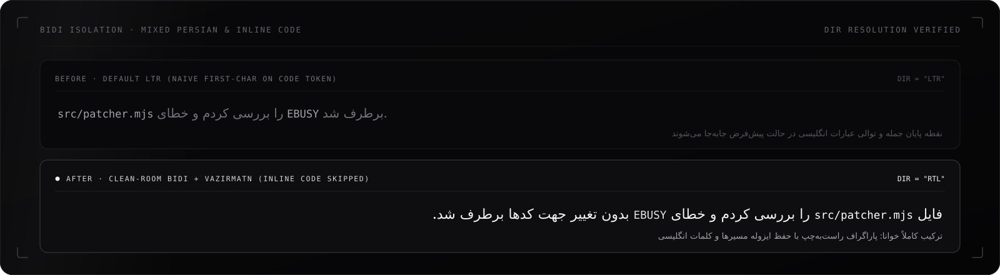

<p align="center">
  <strong>English</strong> · <a href="README.fa.md">فارسی (راهنمای فارسی)</a> · <a href="https://irdcode.github.io/antigravity-persian-rtl/">Docs Page</a>
</p>

<p align="center">
  
</p>

# Antigravity Persian RTL

**Hardened offline RTL (right-to-left) layout engine, bundled Vazirmatn variable typography, and auto-repatch Windows launcher for Google Antigravity Desktop.**

Google Antigravity Desktop renders chat responses, markdown lists, and composer inputs inside an LTR container (`dir="ltr"`). When Persian (Farsi), Arabic, Kurdish Sorani, Urdu, or Pashto paragraphs contain English filenames, error codes, or commands, word order reverses, ending punctuation jumps to the wrong side, and fallback fonts misalign glyph metrics.

`antigravity-persian-rtl` injects a strictly sandboxed bidirectional layout controller (`unicode-bidi: isolate` + per-block `dir="rtl"` / `dir="ltr"`) directly into Antigravity Desktop's `app.asar` while locking `<pre>`, `<code>`, Monaco Editor, and integrated terminals strictly LTR.

<p align="center">
  
</p>

<p align="center">
  
</p>

### Clean-Room BiDi Architecture Highlights

Implemented from scratch in `src/bidi-engine.js` and `src/runtime-patch.js` with zero external runtime code dependencies:

- **Inline-Code & URL-Aware Direction Detection:** Skips nested `<code>`, `<pre>`, `<kbd>`, `<samp>`, `.font-mono`, `.monaco-editor`, `.xterm`, `.terminal`, and leading URLs/relative file paths when resolving paragraph direction — paired with explicit `unicode-bidi: isolate !important` on managed blocks so a Persian message starting with `` `src/patcher.mjs` رو بررسی کردم `` or `src/patcher.mjs` stays **`dir="rtl"`** with clean punctuation.
- **BaseWindow & WebContentsView Compatibility (`v2.32+`):** Resolves `hubContents` when present on modern `BaseWindow` builds (`v2.32.0`) and falls back to `win.webContents` (`v2.31.x`), preserving identical `127.0.0.1` origin checks.
- **Non-Destructive Toggle (`Alt+R`):** Tracks managed elements via `data-ag-rtl-managed` and saves pre-existing `dir` values in `data-ag-rtl-prev`, so toggling RTL off restores Antigravity's native attributes untouched.
- **Scoped Typography Injection:** Loads bundled `Vazirmatn-Variable.woff2` (`@font-face unicode-range` restricted to Arabic/Persian blocks) on chat/prose/composer rules only, preserving UI icon and code fonts.
- **Batched Incremental Observer & Live Sliders:** Schedules DOM updates over `requestAnimationFrame` + dirty-root batching without layout-thrashing `window.resize` events, paired with live `Line Height` (`1.0–3.0×`) and `Font Size` (`11–22 px`) value readouts.

---

## Requirements

- **Google Antigravity Desktop** (verified on **Antigravity Desktop v2.31.2** live UI and **v2.32.0** `app.asar` ASAR/VM checks, Windows 10/11 x64)
- **Node.js `>= 20.0.0`** (`winget install OpenJS.NodeJS.LTS` or [nodejs.org](https://nodejs.org/))
- First run installs the single production dependency (`@electron/asar`) automatically if missing. No runtime internet connection is ever required after installation.

---

## Quick Start (Windows)

1. Clone or download this repository to a permanent folder (for example `C:\Tools\antigravity-persian-rtl`).
2. Double-click **`Launch-Antigravity-RTL.bat`**.
   - On first run, it installs `@electron/asar` if needed, closes Antigravity if open (with prompt), creates an untouched `app.asar.bak` backup, applies the hardened RTL patch, and launches `Antigravity.exe`.
   - On subsequent runs, if `app.asar` is already patched, it starts `Antigravity.exe` immediately.
   - After any official Antigravity Desktop update overwrites `app.asar`, launching via **`Launch-Antigravity-RTL.bat`** automatically detects the unpatched update and re-applies RTL before starting the app.
3. Optional: right-click **`Launch-Antigravity-RTL.bat`** -> **Send to -> Desktop (create shortcut)** so your regular desktop shortcut always preserves RTL across app updates.

### Included Windows Batch Tools

| File | Purpose |
| :--- | :--- |
| `Launch-Antigravity-RTL.bat` | Verifies ASAR state, auto-patches if fresh or updated, and launches `Antigravity.exe` |
| `Diagnose-Antigravity-RTL.bat` | Runs non-destructive health diagnostics (`doctor`) covering Node, ASAR integrity, `.bak` backup state, and lock status |
| `Restore-Antigravity-Original.bat` | Safely reverts `app.asar` back to the untouched official release (uses `.bak` or self-healing strip fallback) |

---

## Controls & Shortcuts Inside Antigravity

Once launched, an **RTL** button appears in the top bar:

- **`Alt+R`** — Instantly toggle RTL processing ON/OFF without restarting Antigravity
- **Enable RTL** — Auto-detects paragraph direction from the first strong character (`Persian/Arabic` -> RTL, `Latin` -> LTR)
- **Force RTL** — Forces RTL direction across markdown prose, chat messages, and composer blocks (still keeps `pre`, `code`, `.monaco-editor`, and `.terminal` strictly LTR)
- **Custom Fonts** — Optional system font overrides for Persian, English, and Monospace code (validated against strict token allowlist; empty defaults to bundled offline `Vazirmatn-Variable.woff2`)
- **Typography Sliders** — Live **Line Height (`1.0`–`3.0`)** and **Font Size (`10`–`28 px`)** with one-click reset buttons

Settings persist locally to `~/.antigravity-rtl.json`.

---

## CLI Usage (Windows, macOS & Linux)

Auto-detection searches standard Antigravity Desktop paths on Windows (`%LOCALAPPDATA%\Programs\antigravity\resources\app.asar`, `%LOCALAPPDATA%\Programs\Antigravity\...`, `%PROGRAMFILES%\...`), macOS (`/Applications/Antigravity.app/Contents/Resources/app.asar`, `~/Applications/...`), and Linux (`/opt/Antigravity/...`, `/opt/antigravity/...`, `/usr/lib/antigravity/...`, `~/.local/share/antigravity/...`). You can also pass `--path <app.asar|install-dir>` explicitly.

> [!NOTE]
> The `.bat` and PowerShell launcher wrappers are Windows-specific. On macOS and Linux, use the Node CLI commands below. End-to-end verification in this release covers **Antigravity v2.31.2** (live UI) and **v2.32.0** (`BaseWindow`/`hubContents` real `app.asar` repack + `node:vm` tests) on Windows; macOS and Linux support the Node CLI path resolution via synthetic ASAR test coverage.

```bash
npm install --omit=dev
npm run doctor                 # Non-destructive health check
npm run patch                  # Apply patch (fails if already patched unless --if-needed is passed)
node src/patcher.mjs patch --if-needed
npm run status                 # Inspect current patch/backup state
npm run restore                # Revert to original official app.asar
```

CLI flags supported on all subcommands (`status`, `doctor`, `patch`, `restore`):

- `--path "<file_or_dir>"` — Target a custom `app.asar` path or Antigravity installation directory
- `--json` — Emit machine-readable JSON diagnostics and structured error payloads (`code`, `cause`, `fix`)
- `--if-needed` — (`patch` only) Skip repacking if already patched with the current hardened marker
- `--strict-backup` — (`restore` only) Require a valid `app.asar.bak` instead of falling back to strip recovery

---

## Security Audit & Guarantees

This edition intentionally strips telemetry, external requests, and remote code-fetching mechanics:

| Security Control | Implementation |
| :--- | :--- |
| **Origin Allowlist** | Both `dom-ready` CSS/JS injection and `console-message` config listener verify `^https?://127\.0\.0\.1:\d+` strictly |
| **Config Sanitization** | Reads & writes to `~/.antigravity-rtl.json` sanitize keys (`faFont`, `enFont`, `codeFont` restricted to `^[\p{L}\p{N} ._-]{0,64}$`, numeric clamps on `fs` `10..28` and `lh` `1.0..3.0`, booleans only) |
| **Zero Network Calls** | Zero `fetch`, zero `api.github.com` polling, zero `shell.openExternal`, zero star-prompt popups |
| **Offline Font Bundle** | `Vazirmatn-Variable.woff2` (`unicode-range` Arabic blocks only) is embedded inside `app.asar` (`dist/Vazirmatn-Variable.woff2`) |
| **Safe ASAR Updates** | Pre-validates hook anchor (`void win.loadURL(url);`) BEFORE creating `.bak`; compiles final `dist/utils.js` inside `node:vm` before packing; preserves `.unpacked` files alongside `app.asar.unpacked`; swaps via atomic temp files with rollback |

---

## Safe Revert & Self-Healing Recovery

You can always revert Antigravity Desktop cleanly without touching your chat history or workspaces (stored separately under `%APPDATA%\Antigravity`):

1. **`exact_backup` (default when `app.asar.bak` is clean):** Restores the byte-identical backup over `app.asar`, verifies SHA-256 parity against `.bak`, and removes `app.asar.bak`.
2. **`strip_fallback` (when `.bak` was deleted or overwritten cleanly):** Extracts `dist/utils.js`, removes the bounded patch block (`/* ANTIGRAVITY PERSIAN RTL ... END ANTIGRAVITY PERSIAN RTL */` as well as earlier legacy markers), deletes `dist/Vazirmatn-Variable.woff2`, repacks `app.asar`, and verifies zero RTL artifacts remain.
3. **`already_original`:** Safe idempotent exit if `app.asar` is already unpatched.

---

## Error Reference & Fixes

Every launcher and CLI failure prints an explicit error code, root cause, and exact recovery action:

| Error Code | Likely Cause | Fix |
| :--- | :--- | :--- |
| `ANTIGRAVITY_RUNNING` / `FILE_LOCKED` / `ANTIGRAVITY_STILL_RUNNING` | `Antigravity.exe` or its System Tray/helper process holds an open handle on `app.asar` | Quit Antigravity completely (check System Tray or Task Manager) and re-run `Launch-Antigravity-RTL.bat` |
| `NODE_NOT_FOUND` / `NODE_TOO_OLD` | Node.js is missing from `PATH` or older than `20.0.0` | Install/upgrade Node.js LTS (`winget install OpenJS.NodeJS.LTS` or [nodejs.org](https://nodejs.org/)) |
| `NPM_NOT_FOUND` / `DEPS_INSTALL_FAILED` | `@electron/asar` has not been installed and offline/proxy state blocked `npm` | Open terminal in repo folder with internet access and run `npm install --omit=dev` |
| `ASAR_NOT_FOUND` / `EXE_NOT_FOUND` | Antigravity Desktop installed in a non-standard folder or missing binary | Pass `-AsarPath "C:\path\to\resources\app.asar"` (PS1) or `--path "<path>"` (Node CLI) |
| `MISSING_PATH_VALUE` / `PATH_NOT_FILE` | `--path` was passed without a value or points to a non-Antigravity directory | Supply the exact `resources\app.asar` file path or Antigravity install root |
| `PERMISSION_DENIED` / `READ_ONLY_FS` | Installed under `Program Files` or restricted location | Right-click `.bat` and choose **Run as administrator**, or move install to user-writable path |
| `DISK_FULL` | Target drive ran out of free space during temp ASAR repack | Free at least **30 MB** and retry (original `app.asar` remains untouched) |
| `ANCHOR_NOT_FOUND` | A future Antigravity update altered `void win.loadURL(url);` in `dist/utils.js` | Original `app.asar` was **not** modified; run `Diagnose-Antigravity-RTL.bat` and open a Version Compatibility issue |
| `CORRUPT_ASAR` | Existing `app.asar` has a truncated/invalid ASAR header | Run `Restore-Antigravity-Original.bat` if a clean `.bak` exists, otherwise reinstall Antigravity Desktop |
| `LEGACY_PATCH_UNRECOVERABLE` | A different third-party patcher modified `dist/utils.js` without `.bak` | Reinstall official Antigravity Desktop cleanly (`%APPDATA%` chats/settings stay intact) |
| `NO_BACKUP` / `PATCHED_BACKUP` / `CORRUPT_BACKUP` | Triggered under `--strict-backup`, or `.bak` itself contains patched/corrupt data | Omit `--strict-backup` to allow `strip_fallback`, or reinstall Antigravity Desktop cleanly |
| `SCRIPT_SYNTAX_ERROR` / `MISSING_BUNDLE_ASSET` / `POST_PACK_VERIFY_FAILED` | Incomplete download or corrupt repo asset | Re-clone or re-download complete release files; original `app.asar` remains untouched |

---

## Development & Verification

```bash
npm test
```

Runs the offline Node test suite (`test/patcher.test.mjs`), covering synthetic ASAR patching, idempotency, update re-patching, `exact_backup` + `strip_fallback` recovery, legacy auto-upgrade, inline-code-first BiDi isolation, non-destructive `restoreAll`, origin guard enforcement, config sanitization, ASAR `.unpacked` preservation, and structured error diagnostics.

---

<div dir="rtl">

## خلاصه فارسی و عبارت‌های جستجو

اگر در محیط چت **Google Antigravity Desktop** هنگام خواندن یا نوشتن متن‌های ترکیبی **فارسی / عربی و انگلیسی** (مانند مسیر فایل‌ها، نام متغیرها، کدهای خطا و دستورات ترمینال) دچار به‌هم‌ریختگی خط، پرش علامت نقطه و پرانتز یا مشکل فونت می‌شوید:

- راهنمای کامل فارسی با تصاویر و جدول خطاها: **[README.fa.md](README.fa.md)**
- برای اجرای خودکار و ماندگار در برابر آپدیت‌های بعدی: فایل **`Launch-Antigravity-RTL.bat`**
- برای بررسی سلامت نصب بدون تغییر در برنامه: فایل **`Diagnose-Antigravity-RTL.bat`**
- برای بازگشت کامل به نسخه رسمی بدون پچ (حتی بدون فایل پشتیبان): فایل **`Restore-Antigravity-Original.bat`**

کلیدواژه‌ها: راست‌چین کردن آنتی‌گراویتی، حل مشکل فارسی در Antigravity Desktop، فونت وزیرمتن آفلاین آنتی‌گراویتی، جداسازی متن فارسی و انگلیسی (BiDi Isolate).

</div>

---

## License & Third-Party Components

This project is released under the **MIT License** (`Copyright (c) 2026 Kiarash Javanbakht (IRDcode)`) — see [LICENSE](LICENSE) and [THIRD_PARTY_NOTICES.md](THIRD_PARTY_NOTICES.md):

- Bundled offline typeface: **[Vazirmatn](https://github.com/rastikerdar/vazirmatn)** by Saber Rastikerdar (`SIL OFL-1.1`).
- ASAR tooling: **[@electron/asar](https://github.com/electron/asar)** (`MIT License`).
